<div align="center">

<picture>
  <source media="(prefers-color-scheme: dark)" srcset="frontend/public/logo-horizontal-dark.svg">
  <source media="(prefers-color-scheme: light)" srcset="frontend/public/logo-horizontal.svg">
  
</picture>

# CryptPilot

### Your money, *explained*. Every wallet, *checked*.

An AI personal-finance copilot that forecasts your next 90 days, plus a graph-verified Bitcoin wallet risk check, in one app.

<a href="assets/showcase/cryptpilot-showcase.mp4">
  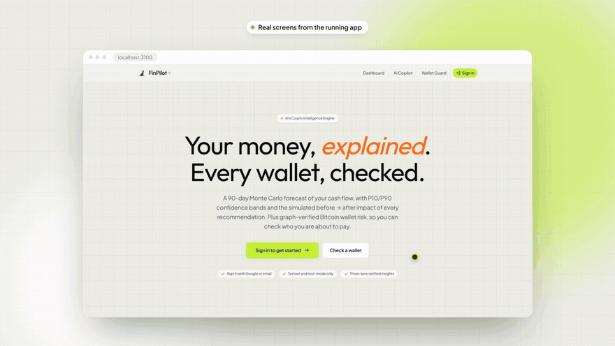
</a>

<sub>▶ <a href="assets/showcase/cryptpilot-showcase.mp4"><b>Watch the full showcase video</b></a> (1080p, 89 s, music only). Every screen in it was recorded from the running app.</sub>

<br/>

[](https://nextjs.org/)
[](https://react.dev/)
[](https://fastapi.tiangolo.com/)
[](https://python.org/)
[](https://www.typescriptlang.org/)
[](https://tailwindcss.com/)
[](#-interactive-architecture)
[](#-honest-status)

[Showcase](#-the-showcase) · [Features](#-what-it-does) · [Architecture](#-interactive-architecture) · [How it works](#-how-a-wallet-check-flows) · [The maths](#-the-maths) · [Run it](#-run-it-locally) · [Status](#-honest-status)

</div>

---

## ✦ The showcase

Most money apps look backward: they tell you where your money went. CryptPilot looks forward, and it also checks who you are about to pay.

| | |
|:--|:--|
| **FinPilot**, the copilot | Reads your accounts and transactions, scores your financial health on 5 pillars, simulates thousands of possible next months, and answers questions with facts from your own records. |
| **Cryptiq**, the wallet guard | Paste a Bitcoin address and get **ALLOW / WARN / BLOCK / UNKNOWN**, a 0 to 100 risk score, the evidence graph around it, and a plain-language explanation in English or Hindi. |

> [!NOTE]
> The video and the screenshots below come from a local run on **demo data**: seeded FinPilot personas, and a **synthetic** wallet dataset for the crypto service (the app itself labels these results "Synthetic or mock data"). Nothing in them is a real person or a real wallet.

---

## ✦ What it does

<table>
<tr>
<td width="50%" valign="top">

### 01 · Dashboard
Balances, income, spending and budgets in one calm view, plus a **Financial Health Index**: a weighted 5-pillar score (cash flow, debt, savings, emergency fund, spending consistency).

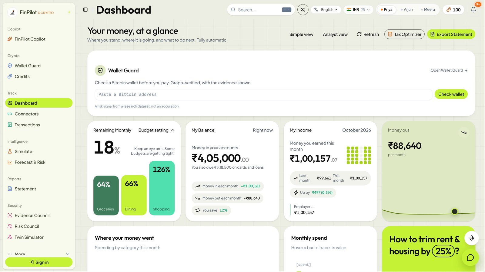
</td>
<td width="50%" valign="top">

### 02 · Forecast & Risk
A **Monte Carlo** cash-flow forecast: **2,000 seeded paths** by default (500 to 10,000 configurable), P10/P50/P90 bands, shortfall probability, scenario comparison, and a backtest of the model's own accuracy.

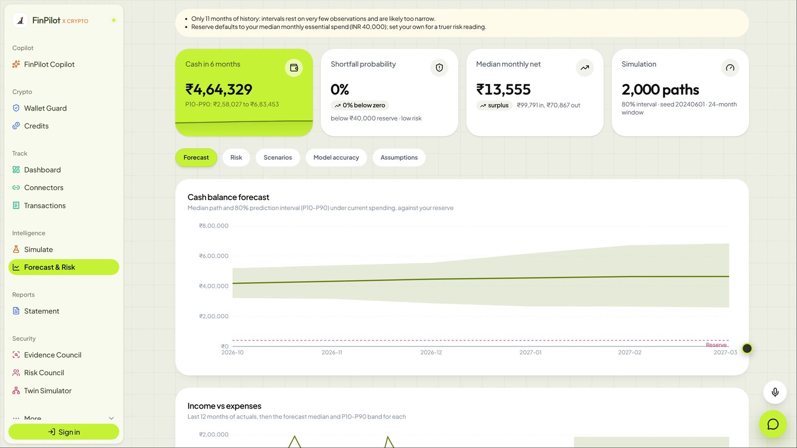
</td>
</tr>
<tr>
<td width="50%" valign="top">

### 03 · FinPilot Copilot
Ask anything about your money. Answers separate **facts from your records** from **recommended actions**, each with confidence and simulated impact, and a one-click **Test in What-If Simulator**. Voice input and wallet-aware replies included.

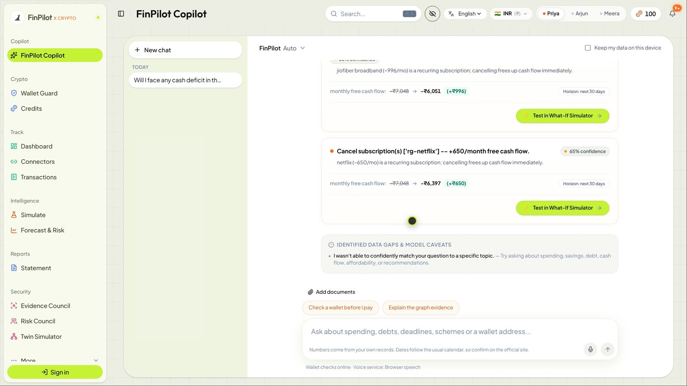
</td>
<td width="50%" valign="top">

### 04 · Simulate
Flip subscriptions off on paper first. **"You save"** updates live, and the 12-month chart shows how it compounds.

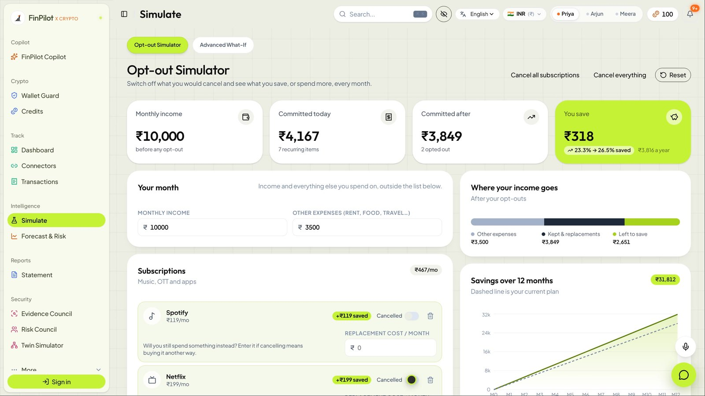
</td>
</tr>
<tr>
<td colspan="2" valign="top">

### 05 · Wallet Guard
Check a Bitcoin address **before** you send. You get a verdict and risk score, the nearest flagged wallet, OFAC and Ransomwhere matches, an inspectable **1 to 3 hop evidence graph**, and an explanation grounded only in the retrieved evidence. A repeat check within 10 minutes is free, and UNKNOWN is free (and never shown as "safe").

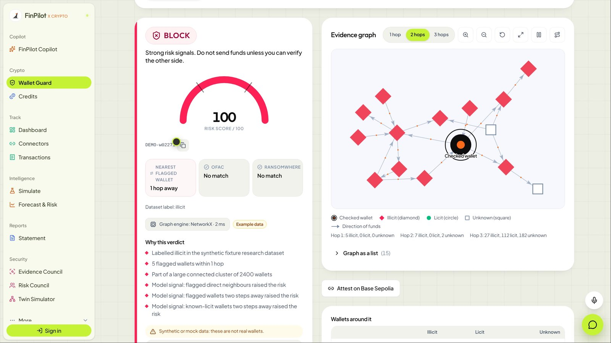
</td>
</tr>
<tr>
<td width="50%" valign="top">

### 06 · Statement
A printable monthly health statement with a **real SHA-256 audit hash** of the figures it prints (recomputable from the canonical JSON shown beside it), plus optional anchoring on **Base Sepolia** via EAS.

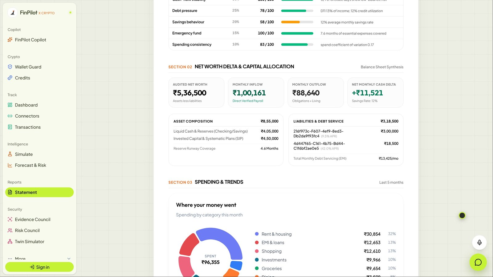
</td>
<td width="50%" valign="top">

### 07 · Tax · 08 · Credits
**New vs old Indian tax regime**, compared side by side with deductions. **Credits** pay for wallet checks through a Dodo test-mode card or a Cake Wallet testnet / demo invoice. No real money moves.

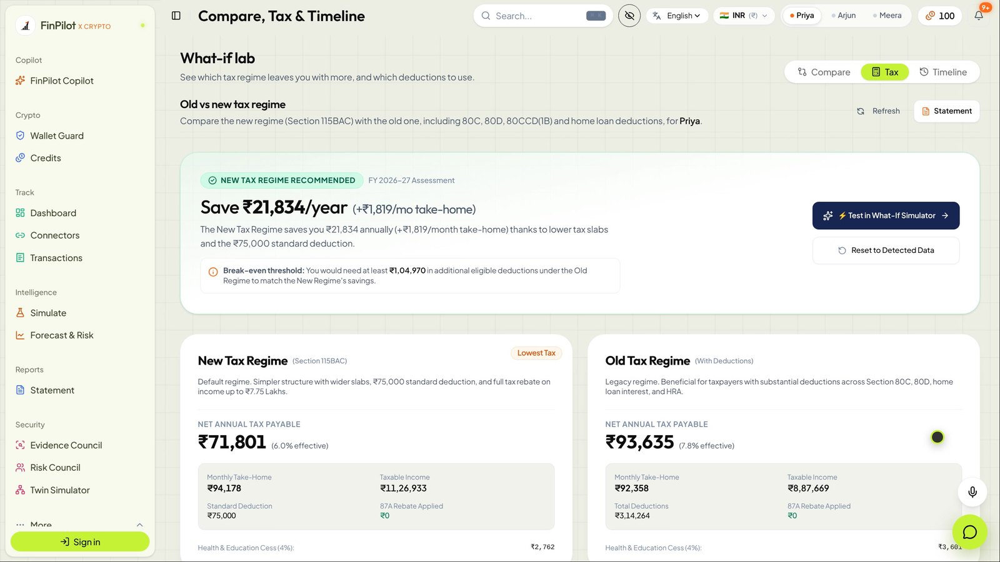
</td>
</tr>
</table>

<details>
<summary><b>And more in the app</b>: Risk Council, Evidence Council, Twin Simulator, Connectors, Goals, Household…</summary>
<br/>

- **Risk Council**: seven AI specialists (Strict Auditor, Cash-Flow Realist, Debt Hawk, Fraud Sentinel, Behavioural Coach, Growth Optimist, Peer Benchmarker) read a short summary of your finances, never your raw transactions, vote on your risk and record their dissent. List a wallet and an eighth, the **Chain Analyst**, adds graph evidence.
- **Evidence Council**: nine agents examine your ledger one after another; with a wallet listed, the Chain Analyst runs as a tenth stage before the Risk Scorer.
- **Twin Simulator**: simulate a fraud attempt against your spending pattern, optionally with a wallet.
- **Connectors**: bank accounts, Google Sheets, Gmail & Drive invoices, mutual funds, Plaid, plus the Dodo and Cake Wallet payment rails.
- **Household, Goals, Budgets, Transactions, Timeline, Security (TOTP MFA)**, English / Hindi / Marathi UI, INR and other currencies, three demo personas.

</details>

---

## ✦ Interactive architecture

> GitHub renders the diagram below live: **drag to pan, scroll or use the controls to zoom**, and open it full-screen with the expand button. Then use the **layer explorer** under it to jump straight to the code for any box.

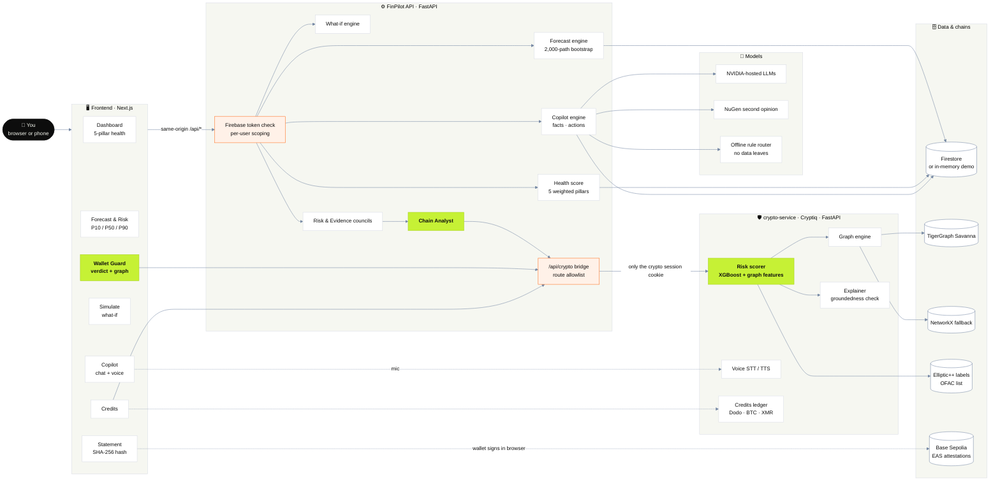

<sub>Lime = the wallet-risk path · orange = trust boundaries · white cylinders = storage and chains. Optional providers (LLMs, voice, TigerGraph, Dodo) only run when their key is configured; everything falls back to something that works offline.</sub>

### 🧭 Layer explorer

<details>
<summary><b>🖥️ Frontend</b> · Next.js 16 App Router, React 19, Tailwind v4, Framer Motion, Recharts</summary>
<br/>

| Box | What it is | Code |
|---|---|---|
| Dashboard | KPI bento, budgets, Financial Health Index | [`frontend/app/(app)/dashboard`](frontend/app/(app)/dashboard) · [`components/dashboard`](frontend/components/dashboard) |
| Forecast & Risk | Monte Carlo bands, shortfall, backtest | [`frontend/app/(app)/forecast-risk`](frontend/app/(app)/forecast-risk) · [`components/forecast-risk`](frontend/components/forecast-risk) |
| Copilot | Chat, prompt chips, answer contract, voice, inline wallet cards | [`frontend/app/(app)/copilot`](frontend/app/(app)/copilot) · [`components/AnswerContractView.tsx`](frontend/components/AnswerContractView.tsx) · [`components/crypto/voice`](frontend/components/crypto/voice) |
| Simulate | Opt-out and advanced what-if | [`frontend/app/(app)/simulate`](frontend/app/(app)/simulate) · [`components/simulate`](frontend/components/simulate) |
| Wallet Guard | Verdict card, progress steps, evidence graph | [`frontend/app/(app)/wallet-guard`](frontend/app/(app)/wallet-guard) · [`components/crypto/guard`](frontend/components/crypto/guard) · [`components/crypto/graph`](frontend/components/crypto/graph) |
| Statement | Printable report, audit hash, anchor panel | [`frontend/app/(app)/statement`](frontend/app/(app)/statement) · [`components/statement`](frontend/components/statement) |
| Credits | Balance, packs, crypto invoices | [`frontend/app/(app)/credits`](frontend/app/(app)/credits) · [`components/crypto/credits`](frontend/components/crypto/credits) |
| Web3 | Base Sepolia wallet + EAS client | [`components/crypto/web3`](frontend/components/crypto/web3) · [`lib/crypto/eas`](frontend/lib/crypto/eas) |

</details>

<details>
<summary><b>⚙️ FinPilot API</b> · FastAPI: analytics, forecasting, copilot, councils, crypto bridge</summary>
<br/>

| Box | What it is | Code |
|---|---|---|
| Auth & scoping | Firebase ID-token verification, subject must match `user_id` | [`backend/app/core`](backend/app/core) |
| Forecast engine | Joint month bootstrap, 2,000 seeded paths, P10/P50/P90, backtest | [`backend/app/plan/forecast.py`](backend/app/plan/forecast.py) · [`plan/forecast_risk.py`](backend/app/plan/forecast_risk.py) |
| Health score | 5 weighted pillars | [`backend/app/analytics`](backend/app/analytics) |
| What-if engine | Counterfactual scenarios behind Simulate | [`backend/app/simulate`](backend/app/simulate) |
| Copilot engine | NVIDIA-hosted models, NuGen second opinion, offline rule router | [`backend/app/copilot`](backend/app/copilot) |
| Councils | Risk Council, Evidence Council, Chain Analyst | [`backend/app/security`](backend/app/security) |
| Crypto bridge | Allowlisted proxy to the crypto service; forwards only `cryptiq_sid` | [`backend/app/crypto_bridge`](backend/app/crypto_bridge) |

</details>

<details>
<summary><b>🛡️ crypto-service (Cryptiq)</b> · FastAPI: scoring, graph engines, explanations, voice, billing</summary>
<br/>

| Box | What it is | Code |
|---|---|---|
| Risk scorer | Model with graph features, verdict policy, reasons | [`crypto-service/app/services/model`](crypto-service/app/services/model) |
| Graph engine | TigerGraph (GSQL k-hop queries) or in-memory NetworkX | [`crypto-service/app/services/graph`](crypto-service/app/services/graph) |
| Labels | OFAC list, dataset labels | [`crypto-service/app/services/labels`](crypto-service/app/services/labels) |
| Explainer | LLM explanation, groundedness validator, template fallback | [`crypto-service/app/services/explain`](crypto-service/app/services/explain) |
| Voice | Sarvam / Wispr Flow STT, TTS | [`crypto-service/app/services/voice`](crypto-service/app/services/voice) |
| Billing | Credits ledger, Dodo webhooks, BTC / XMR invoices | [`crypto-service/app/services/billing`](crypto-service/app/services/billing) |
| Benchmark | Raw dump vs graph evidence, tokens and accuracy | [`crypto-service/app/services/bench`](crypto-service/app/services/bench) |

</details>

<details>
<summary><b>🗄️ Data & chains</b> · Firestore, TigerGraph Savanna, NetworkX, Elliptic++, Base Sepolia</summary>
<br/>

- **Firestore** holds FinPilot data per user ([`firestore.rules`](firestore.rules)). Without credentials the API runs on seeded in-memory demo data.
- **TigerGraph Savanna**: 822,942 vertices and 2,775,637 edges loaded and cross-checked against NetworkX (0 differences over 46 compared wallets). Schema and queries: [`crypto-service/app/services/graph/gsql`](crypto-service/app/services/graph/gsql).
- **Elliptic++** research data and the trained model are **not in git** (no stated licence); they are fetched at runtime from a private store by [`scripts/fetch_artifacts.py`](crypto-service/scripts/fetch_artifacts.py).
- **Base Sepolia** (chain id 84532): EAS attestations are signed in the user's own wallet in the browser. No server holds a key.

</details>

---

## ✦ How a wallet check flows

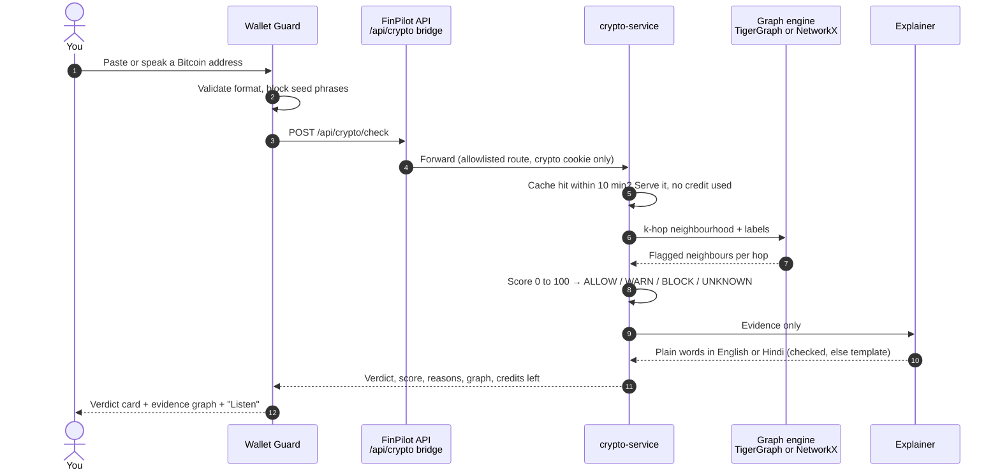

<details>
<summary><b>And the Copilot → Simulator loop</b></summary>
<br/>

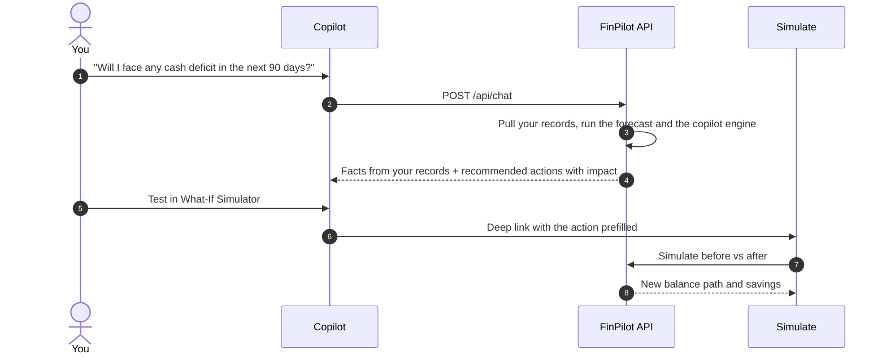

</details>

---

## ✦ The maths

**Financial Health Index**, 0 to 100:

$$\text{Score} = 0.30\,S_{\text{cash flow}} + 0.25\,S_{\text{debt}} + 0.20\,S_{\text{savings}} + 0.15\,S_{\text{emergency}} + 0.10\,S_{\text{consistency}}$$

**Cash-flow forecast**: a joint month bootstrap. For each of $K$ paths (2,000 by default, seeded so the same inputs give the same result), each future month draws a residual vector from your own history and adds it to the recent median:

$$\hat{x}_{k}(m) = \text{median}_{\text{window}}(x) + r_{k,m}, \qquad r_{k,m} \sim \{x_i - \text{median}(x)\}$$

The bands are percentiles across paths, $P_{10}(m),\,P_{50}(m),\,P_{90}(m)$, and the shortfall probability is the share of paths whose cash balance falls below your reserve.

---

## ✦ Run it locally

```bash
git clone <this-repo-url> crypt-pilot && cd crypt-pilot
scripts/run_cryptpilot_demo.sh        # crypto-service :8132 · FinPilot API :8000 · frontend :3100
```

Open **http://localhost:3100**, press **Explore Demo App**, then open **Wallet Guard** and run the **Block** example.

<details>
<summary><b>No dataset? Run the crypto service on its synthetic fixture</b> (this is how the showcase was recorded)</summary>
<br/>

```bash
cd crypto-service && uv sync && make fixture          # fake DEMO- wallets + a small trained model
DATA_DIR=./data/fixture ARTIFACTS_DIR=./data/fixture/artifacts DEMO_MODE=true GRAPH_ENGINE=networkx \
  uv run uvicorn app.main:app --port 8132
```

```bash
cd backend && pip install -r requirements.txt "uvicorn[standard]"
CRYPTO_SERVICE_URL=http://127.0.0.1:8132 FINPILOT_DEMO_MODE=true uvicorn app.main:app --port 8000
```

```bash
cd frontend && npm ci && BACKEND_URL=http://127.0.0.1:8000 npm run build && npm run start -- -p 3100
```

Results from the fixture carry `isMock: true`, and the UI labels them as synthetic.

</details>

<details>
<summary><b>Keys and configuration</b></summary>
<br/>

Everything runs without keys on demo data. Keys switch on the real providers: Firebase (sign-in and persistence), NVIDIA (Copilot), an LLM key for wallet explanations, Sarvam / Wispr Flow (voice), Dodo (test-mode checkout), TigerGraph (graph engine), and an EAS schema UID (on-chain anchoring). Names and where they go: [`ENVIRONMENT.md`](ENVIRONMENT.md), [`docs/CRYPTPILOT_ARCHITECTURE.md`](docs/CRYPTPILOT_ARCHITECTURE.md), [`docs/GO_LIVE.md`](docs/GO_LIVE.md).

</details>

---

## ✦ Honest status

| Area | Status |
|---|---|
| crypto-service (API, scoring, billing logic, voice, explanations) | ✅ 208 unit tests passing |
| FinPilot bridge, Chain Analyst, payment rails | ✅ 97 unit tests passing |
| TigerGraph engine | ✅ Loaded and cross-checked against NetworkX; p50 ≈ 670 ms per check from the sandbox |
| All new screens | ✅ Driven end to end in Chromium (desktop + 390 px mobile), 0 page errors |
| Dodo checkout, BTC testnet invoice, EAS signing, Wispr Flow | ⏳ Need keys or test funds; not tested live |
| Deployment | ⏳ Not deployed yet |

**Read before trusting a verdict.** The Elliptic++ data covers roughly 2016 to 2018, so most wallets checked today come back UNKNOWN, and **UNKNOWN is not safe**. A verdict is a risk signal from research data, not an accusation. All payments are test mode or testnet. Full detail: [`docs/CRYPTPILOT.md`](docs/CRYPTPILOT.md).

---

## ✦ Security & privacy

- **Per-user isolation**: every `user_id` route verifies the Firebase ID token and its subject; Firestore rules keep documents private.
- **Offline mode**: the Copilot can answer from a deterministic rule router, so your data never leaves the API process.
- **Crypto boundary**: the browser never talks to the crypto service directly; the bridge forwards an explicit route allowlist and only the `cryptiq_sid` cookie, never FinPilot credentials.
- **Seed-phrase guard**: seed phrases and private keys are detected and cleared in Wallet Guard and in voice input; they are never sent.
- **TOTP MFA**, an audit log of mutations, and hardened CSV upload limits.

---

## ✦ Project layout

```
crypt-pilot/
├── frontend/          Next.js 16 app (FinPilot UI + Wallet Guard, Credits, voice, web3)
├── backend/           FinPilot API (FastAPI): analytics, forecast, copilot, councils, crypto bridge
├── crypto-service/    Cryptiq API (FastAPI): scorer, TigerGraph/NetworkX, explainer, voice, billing
├── docs/              Architecture, honest status, API contract, go-live guide
├── brand/             Logo system and guidelines
├── assets/showcase/   Showcase video, teaser and screenshots
└── scripts/           One-command local demo launchers
```

<div align="center">
<br/>

<br/>
<sub>Built with Next.js, FastAPI and TigerGraph. Payments are test mode only.</sub>
</div>
