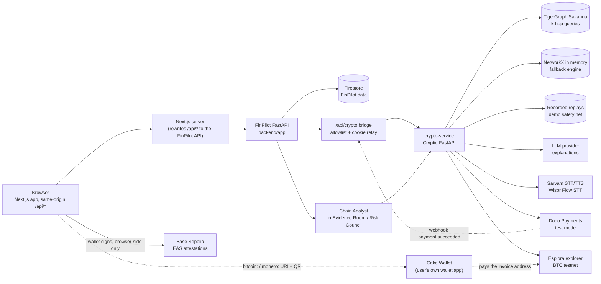
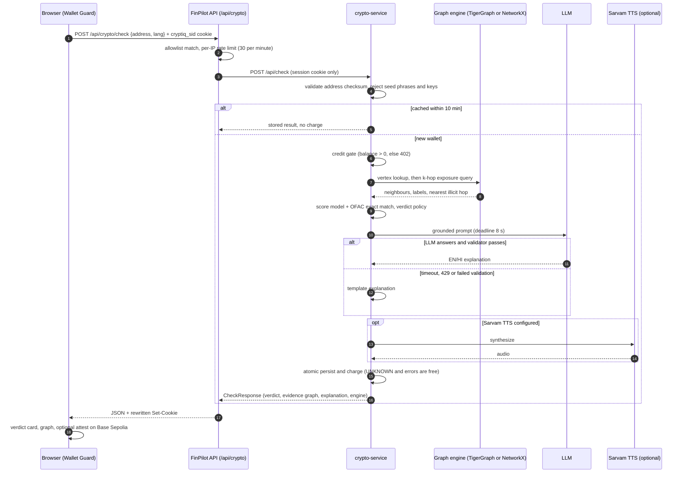
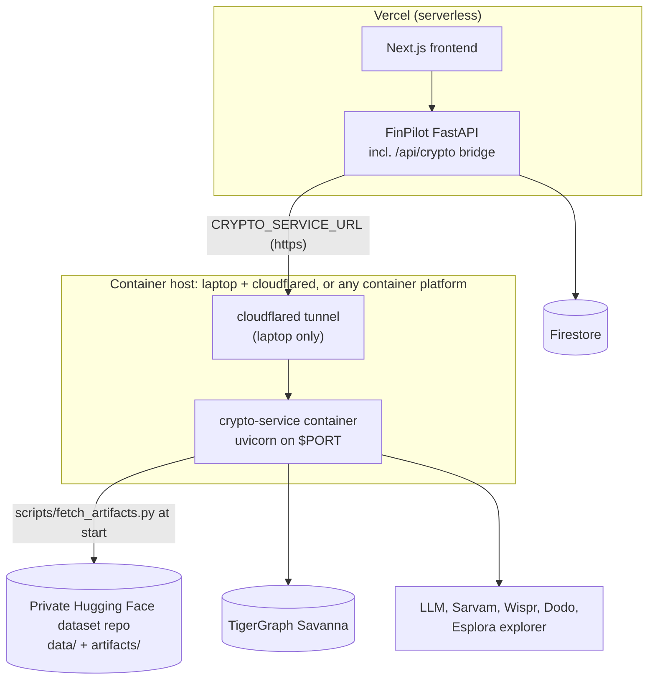

# CryptPilot architecture

How the merged product fits together, how a wallet check with credits flows, where each piece is meant to be deployed, and every environment variable the merge added. Companion to [CRYPTPILOT.md](CRYPTPILOT.md) (what was built and what is verified). Diagrams show what exists in the code; boxes drawn for optional providers only run when their key is configured.

## 1. Component map

Key points:

- The browser never talks to the crypto service directly. It calls `/api/crypto/*` on the FinPilot API; `backend/app/crypto_bridge/router.py` forwards a fixed allowlist (health, demo-wallets, check, check/stream, credits, checkout, crypto-invoice, transcribe, audio, benchmark, webhooks/dodo) and nothing else. It forwards only the `cryptiq_sid` cookie, drops `Authorization` and FinPilot cookies, and answers `GET /api/crypto/status` itself.
- Crypto routes use anonymous cookie sessions, not FinPilot (Firebase) auth, so a visitor can use Wallet Guard without signing in.
- The Chain Analyst calls the service from the server (`app/crypto_bridge/client.py`, cookie-less, never raises). If the service is unreachable the agent abstains.
- `CRYPTO_SERVICE_URL` is read on every call, stays server-side, and an empty value disables the bridge.
- In development the Next.js dev server only forwards `/api/*` when `BACKEND_URL` or `NEXT_PUBLIC_API_URL` is set (see `frontend/next.config.ts`). Without one of them, `/api/crypto/*` returns 404 from the frontend.
- EAS attestations are signed in the user's wallet in the browser on Base Sepolia (chain id 84532). No server holds a key. The 5-field schema is `string subjectAddress,string chain,uint8 riskScore,string verdict,bytes32 reportHash`; statements reuse it (subject `finpilot-monthly-statement:<period>`, chain `finpilot`, verdict `STATEMENT_ANCHOR`).

## 2. Sequence: a wallet check with credits

Buying credits (separate flow): `POST /api/crypto/checkout` returns a Dodo test-mode checkout URL; after payment Dodo calls `/api/crypto/webhooks/dodo` (signature headers forwarded byte for byte, Standard Webhooks verification, idempotent ledger entry) and the browser lands on `/credits/success`. For Cake Wallet, `POST /api/crypto/crypto-invoice` returns a `bitcoin:` or `monero:` URI plus QR; the page polls `GET /api/crypto/crypto-invoice/{id}` every 10 s. BTC is matched by looking for a payment of the exact amount (random 1 to 999 sat offset) to the receive address after the invoice was created; XMR is demo only and not confirmed automatically.

## 3. Deployment

Why the crypto service is a separate container, not part of the Vercel project:

| Item | Reported in the earlier Cryptiq notes (4 CPUs, 16 GB RAM, real Elliptic++ data); not re-measured in this repository |
|---|---|
| Scorer only (what a TigerGraph-backed deployment needs): load / peak RSS | 1.1 s / 1,006 MB; score median 14.4 ms, p95 20.3 ms |
| Full API with the NetworkX engine (graph in memory): startup / RSS | 28 s / 2,605 MB |
| Image size | 952 MB without ffmpeg, 1.58 GB with ffmpeg |

So a serverless function is not a fit: the scorer needs about 1 GB and the NetworkX engine about 2.6 GB. A 2 GB machine is enough only for a TigerGraph-backed (or replay-only) deployment. The earlier notes also report TigerGraph query time over a network (p50 669.86 ms, p95 774.72 ms); that workspace was suspended on 2026-10-29, so it was not reproduced. Deployed latency is **not measured**.

Data never ships in the image or the repo (Elliptic++ has no stated licence). At start the container runs `python -m scripts.fetch_artifacts`, which downloads `data/` and `artifacts/` from a **private** Hugging Face dataset repo (`ARTIFACTS_REPO`, read token in `HF_TOKEN`), allowlisted paths only, with a size cap, and never logs the token. An earlier run reported 27 files, 232,036,359 bytes, 7.5 s (not re-run here).

Hosting options:

- **Hugging Face Docker Spaces** need a PRO plan (per the project owner; not re-checked), so they are not the free route.
- **Laptop + cloudflared tunnel** (what `crypto-service/scripts/run_on_laptop.ps1` does on Windows, about 3 GB of free RAM): run the container or `uvicorn` locally and expose it with `cloudflared tunnel --url http://127.0.0.1:<port>`, then set `CRYPTO_SERVICE_URL` on the FinPilot API to the tunnel URL. That wrapper script has not been run on Windows.
- **Any container host** that can run `crypto-service/Dockerfile` (listens on `$PORT`, healthcheck on `/api/health`). `crypto-service/fly.toml` and `DEPLOY.md` describe Fly.io (may need a payment card; pricing not checked). One machine, one uvicorn worker: SQLite and the in-process cache do not scale horizontally.
- Cookies: serve the service through the FinPilot origin (this is what the bridge does) so `cryptiq_sid` is first-party. With a separate site and `SameSite=None`, browsers that block third-party cookies create a new session with free credits on every request.
- The Dodo webhook URL must be publicly reachable: point it at `https://<finpilot-domain>/api/crypto/webhooks/dodo`.

Nothing is deployed from this repository yet.

## 4. Environment variables

Names only. Never commit values. `.env.example` files list the names.

### FinPilot API and frontend (added or relevant to the merge)

| Name | Service | Required? | Purpose |
|---|---|---|---|
| `CRYPTO_SERVICE_URL` | FinPilot API | Required for any crypto feature | Base URL of the crypto service (server-side only, never sent to the browser). Code default is `http://127.0.0.1:8200` if unset, but the documented standard is `http://127.0.0.1:8132` (set it explicitly); an empty string disables the bridge. |
| `CRYPTO_TRUST_PROXY` | FinPilot API | Optional | `true` only behind a proxy you control: then `X-Forwarded-For` / `X-Forwarded-Proto` are believed (per-visitor rate limiting, Secure-cookie handling). Leave unset locally. |
| `FINPILOT_DEMO_MODE` | FinPilot API | Optional (default `true`) | Demo personas and seeded data. |
| `NEXT_PUBLIC_API_URL` | Frontend (build time) | Local dev: effectively required | Where the browser and the Next.js rewrite send `/api/*`. Local: `http://127.0.0.1:8000`. Do not set on Vercel (same origin). |
| `BACKEND_URL` | Frontend (Next.js server) | Optional | Overrides the rewrite destination in `next.config.ts`. |
| `NEXT_PUBLIC_EAS_SCHEMA_UID` | Frontend (build time) | Optional; needed to sign | UID of the EAS schema registered on Base Sepolia. Without it the sign button is disabled and only the simulated preview works. |
| `NEXT_PUBLIC_WALLETCONNECT_PROJECT_ID` | Frontend (build time) | Optional | Enables WalletConnect wallets; without it only browser and Coinbase wallets are offered. |
| `NEXT_PUBLIC_VOICE_MODE` | Frontend (build time) | Optional | `browser` forces the Web Speech API instead of `POST /api/crypto/transcribe`; anything else is `auto`. |
| `NEXT_PUBLIC_EAS_CONTRACT` | Frontend (build time) | Optional | EAS contract address; default is the Base Sepolia predeploy `0x4200000000000000000000000000000000000021`. |
| `NEXT_PUBLIC_CHAIN_ID` | Frontend (build time) | Optional | Default `84532` (Base Sepolia). Mainnet is not configured. |

`NEXT_PUBLIC_*` values are inlined at build time, so rebuild or restart after changing them. FinPilot's existing variables (Firebase, `GEMINI_API_KEY`, and so on) are documented in `ENVIRONMENT.md` and are unchanged.

### crypto-service (from `crypto-service/.env.example`)

| Name | Required? | Purpose |
|---|---|---|
| `APP_ENV` | Optional (`dev` default) | `prod` refuses to start with placeholder secrets, `SameSite=None` without `Secure`, an empty CORS list, or a missing OFAC list. |
| `DEMO_MODE`, `DEMO_REPLAY`, `REPLAY_FALLBACK` | Optional | Fixture / recorded-replay switches. `DEMO_REPLAY=true` answers from recorded replays (`engine: "replay"`). |
| `FRONTEND_URL`, `CORS_ORIGINS` | Optional | `FRONTEND_URL` is used for the Dodo return URL (`/credits/success`). |
| `SESSION_SECRET`, `ADMIN_TOKEN`, `LOG_SALT` | Required in prod | Secrets. `ADMIN_TOKEN` guards `POST /api/benchmark/run` in prod. |
| `STARTING_CREDITS`, `CACHE_TTL_SECONDS` | Optional | Free credits per new session (3 in the example); cache lifetime (600 s). |
| `COOKIE_SAMESITE`, `COOKIE_SECURE`, `TRUST_FLY_CLIENT_IP` | Optional | Cookie and proxy handling. |
| `DATABASE_URL` | Optional | SQLite by default. |
| `GRAPH_ENGINE` | Optional | `tigergraph` (default) or `networkx`. |
| `TG_HOST`, `TG_GRAPH`, `TG_SECRET` (or `TG_USERNAME` + `TG_PASSWORD`), `TG_QUERY_TIMEOUT_S` | Required for `tigergraph` | TigerGraph Savanna connection. |
| `DATA_DIR`, `ARTIFACTS_DIR`, `OFAC_LIST_PATH`, `RANSOMWHERE_ENABLED`, `RANSOMWHERE_PATH` | Optional | Where the data, model and label lists live. |
| `LLM_PROVIDER`, `LLM_MODEL`, `LLM_API_KEY`, `LLM_BASE_URL`, `LLM_TIMEOUT_S`, `LLM_JSON_MODE`, `BENCHMARK_MAX_TOKENS` | Optional | Explanations; without them the service uses template text. |
| `WISPR_API_KEY`, `WISPR_API_URL` | Optional | Wispr Flow speech-to-text. No key was available, so never exercised. |
| `SARVAM_API_KEY`, `SARVAM_API_URL`, `SARVAM_STT_MODEL`, `SARVAM_TTS_MODEL`, `SARVAM_TTS_SPEAKER` | Optional | Sarvam speech-to-text and text-to-speech. |
| `DODO_API_KEY`, `DODO_WEBHOOK_SECRET`, `DODO_ENV`, `DODO_USAGE_METER_EVENT`, `PACKS_JSON` | Optional; needed for card checkout | `DODO_ENV` must stay `test_mode`. `PACKS_JSON` carries the pack ids, credits, price and `dodoProductId`. |
| `BTC_NETWORK`, `BTC_RECEIVE_ADDRESS`, `BTC_EXPLORER_BASE_URL`, `BTC_CONFIRMATIONS`, `BTC_SATS_PER_USD`, `XMR_DEMO_ADDRESS` | Optional; needed for invoices | Testnet invoice settings. |
| `ARTIFACTS_REPO`, `HF_TOKEN`, `ARTIFACTS_REPO_TYPE`, `ARTIFACTS_REVISION` | Optional; needed for the fetch-at-start deployment | Private Hugging Face repo holding `data/` and `artifacts/`. Also read by `scripts/fetch_artifacts.py` (`ARTIFACTS_MAX_BYTES`, `HF_ENDPOINT` are optional extras). |

## 5. Running it

`scripts/run_cryptpilot_demo.sh` (or `.ps1` on Windows, untested) starts the crypto service on 8132, the FinPilot API on 8000 and the frontend on 3100 with logs in `./.demo-logs/`, and stops them by saved PID. The FinPilot API still needs its usual Firestore setup (emulator or service-account credentials, see `ENVIRONMENT.md`).
